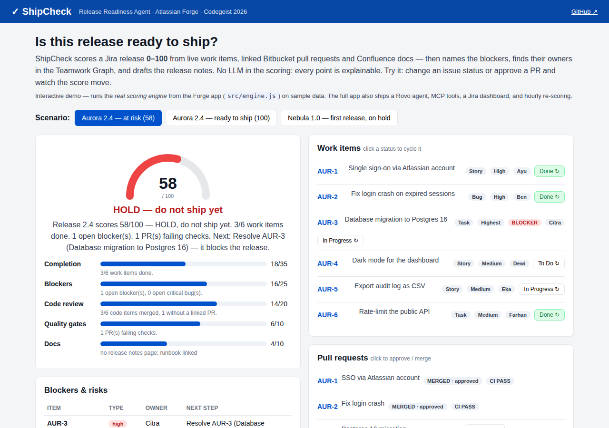

# ShipCheck — Release Readiness Agent

> **"Is this release ready to ship?" — answered with evidence, not vibes.**

ShipCheck is an Atlassian Forge app for **Codegeist 2026** that scores a Jira
release **0–100** from live work items, linked Bitbucket pull requests and
Confluence docs, names the blockers, finds their owners in the **Teamwork
Graph**, and drafts the release notes. A Rovo agent answers the question in
chat; the same capabilities are exposed as MCP tools; a Jira dashboard shows
the score; and an hourly watch re-scores and alerts when a verdict flips.

**No Forge LLM. No paid API.** The score is deterministic and fully
explainable — every point lost maps to a named blocker, risk or missing
artefact. Rovo only narrates the result.

| | |
|---|---|
| **Live interactive demo** | https://codegeist-2026-shipcheck.vercel.app *(runs the real scoring engine on sample data)* |
| **Category** | Apps for Software Teams |
| **Bonus prizes** | Best Agents (Rovo) · Best app with Atlassian MCP · Best Teamwork Graph integration |
| **Submission deadline** | 22 Dec 2026 15:00 EST / **23 Dec 2026 03:00 WIB** |



*Live demo, Aurora 2.4 scenario: 58/100 HOLD — one open blocker, one PR
failing checks, no release notes yet. Click any issue status or approve a PR
and the score moves live.*

## The problem

Release day is a scavenger hunt: the release manager opens Jira to count open
issues, Bitbucket to chase unreviewed PRs, Confluence to check whether anyone
wrote the notes, and Slack to find who owns the blocker. The answer to "can we
ship?" is a gut feeling assembled from four tabs — and it's wrong often enough
that releases slip or ship broken.

ShipCheck turns that into one number, with receipts.

## How scoring works

| Component | Max | Rule |
|---|---|---|
| Completion | 35 | % of the release's work items Done |
| Blockers | 25 | −9 per open blocker (Highest priority / `blocker` label), −4 per open critical bug |
| Code review | 20 | Per code item: merged PR = 1, approved = 0.85, open = 0.4, no PR = 0 |
| Quality gates | 10 | −4 per PR failing CI checks |
| Docs | 10 | Release-notes page +6, runbook linked +4 |

**Verdict:** ≥ 85 **SHIP** · 60–84 **CAUTION** · < 60 **HOLD**.
Hard rule: a release with an open blocker can never be SHIP.

The engine is pure JavaScript with zero dependencies (`src/engine.js`) — the
same file runs in Forge, in the test suite, and in the live demo.

## What is in the app

- **Jira project page** (`jira:projectPage`) — readiness dashboard: gauge,
  breakdown, blocker table, next steps, watch-this-release.
- **Jira issue panel** (`jira:issuePanel`) — release context on any work item.
- **Rovo agent "ShipCheck"** (`rovo:agent`) — four actions, all read-only
  except notes drafting:
  - `get-release-readiness` — score + verdict + breakdown
  - `list-release-blockers` — every blocker with owner + next step
  - `find-release-owners` — assignees from Jira **plus** the people actively
    engaged with each blocker (recent commenters + teams from the Teamwork
    Graph), ranked by engagement
  - `draft-release-notes` — creates the Confluence page
- **MCP server** (`rovo:mcp`) — the same four actions as tools for Rovo Studio
  custom agents and external MCP clients.
- **Teamwork Graph** — curated GraphQL queries (`requestTeamworkGraph`,
  as-user, permission-filtered), 25-row paging, retry with backoff, and honest
  "may be incomplete" notes when a source can't be read.
- **Background watch** — hourly `scheduledTrigger` re-scores watched releases
  and posts a Jira comment when a verdict flips; a `jira:issue_updated`
  trigger re-scores on change (debounced to 5 min).

## Repository layout

```
manifest.yml            Forge manifest (modules, scopes, agent, MCP)
prompts/prompt.md       Rovo agent prompt (resource file)
src/
  engine.js             Pure deterministic scoring + notes + owner ranking
  twg.js                Teamwork Graph client (paging, retry, error handling)
  jira.js               Jira REST: versions, issues, dev-status PRs, comments
  confluence.js         Confluence: find + create release-notes pages
  actions.js            The four Rovo actions (injectable clients, tested)
  index.js              UI resolver, action handlers, triggers, storage
  frontend/index.jsx    UI Kit dashboard + issue panel (@forge/react)
test/                   node:test suite — 38 tests, all passing
demo/                   Standalone interactive demo (same engine, sample data)
docs/ARCHITECTURE.md    Architecture + data flow
INSTALL.md              Full install guide (Atlassian site → deploy → share)
SUBMISSION.md           Devpost submission draft
VIDEO_SCRIPT.md         <5 min demo video script
NEEDS_USER.md           What still needs a human (account, deploy, video)
```

## Quickstart (for judges / developers)

Full steps in [INSTALL.md](INSTALL.md). Short version:

```bash
npm install
npm test            # 38 tests, all passing
npx forge register  # replaces the placeholder app id in manifest.yml
npx forge deploy -e production
npx forge install   # install on your Jira site (org admin approves graph scopes)
```

Then open any Jira project → **ShipCheck — Release Readiness**, or ask Rovo:
*"Is release 2.4 ready to ship?"*

Requirements: a Jira Cloud site (Standard/Premium trial includes Rovo; Rovo is
paid-only), org-admin rights to approve the Teamwork Graph scopes, Forge CLI
15+ and Node 22+.

## Tests

```
npm test
# ℹ tests 38 · pass 38 · fail 0
#   engine.test.js    — scoring bands, blocker caps, PR math, notes, ranking
#   actions.test.js   — all four actions with fake Forge clients
#   twg.test.js       — operation naming, 25-row paging, retry, HTTP-200 errors
```

`forge lint` status: the full **client-side** lint (manifest schema, handlers,
permissions, Teamwork Graph, storage, timeouts — the same linters `forge lint`
runs locally) passes with **0 errors, 0 warnings**, verified 19 Nov 2026 with
Forge CLI 15.1.0's bundled linter. The `forge lint` command itself requires an
Atlassian login, which this VM doesn't have, and server-side lint runs at
deploy time — see NEEDS_USER.md.

## Why this wins

- **Real problem, real audience.** Every software team asks this question every
  release. The demo proves the answer with live data, not a scripted path.
- **Genuinely cross-product.** Jira + Bitbucket (via dev-status) + Confluence +
  Teamwork Graph + Rovo in one coherent flow — the theme of Codegeist 2026 is
  "build with context", and the context here is the whole release.
- **Complete product, not a PoC.** Dashboard, issue panel, agent, MCP tools,
  background watch, history, notes drafting — plus 38 passing tests and a live
  interactive demo anyone can try without an Atlassian account.
- **Free to run.** No Forge LLM, no external paid API. The only AI is Rovo
  itself, narrating a deterministic score.

## License

MIT — see [LICENSE](LICENSE).
