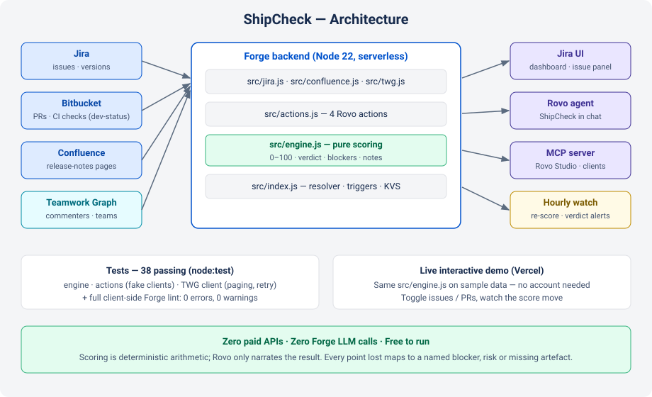

# Architecture — ShipCheck



## Data flow

```
Jira (issues, versions) ──┐
Bitbucket PRs (dev-status)─┼─► src/jira.js ──┐
Confluence (notes pages) ───┘  src/confluence.js
Teamwork Graph (commenters, teams) ─► src/twg.js ──┤
                                                    ▼
                                        src/actions.js  (4 Rovo actions)
                                                    │
                                                    ▼
                                        src/engine.js — pure scoring
                                        (0–100, verdict, blockers,
                                         risks, next steps, notes)
                                                    │
              ┌───────────────────────┬─────────────┼───────────────────┐
              ▼                       ▼             ▼                   ▼
   Jira dashboard +         Rovo agent      rovo:mcp tools    scheduledTrigger
   issue panel (UI Kit)     (chat)          (Rovo Studio +    (hourly re-score,
   via src/index.js                          external clients)  verdict-flip
   resolver                                                     comments)
                                                    │
                                                    ▼
                                        Forge KVS (watched
                                        releases + history)
```

## Why this shape

- **The engine is pure** (`src/engine.js`, zero deps). It is the single source
  of truth for scoring, shared by the Forge backend, the test suite and the
  standalone demo — so the demo literally cannot drift from the app.
- **Actions are thin adapters** (`src/actions.js`). Each Rovo action loads
  release data through injectable clients, then calls the engine. That makes
  every action unit-testable with fakes and keeps Atlassian API details in
  `jira.js` / `confluence.js` / `twg.js`.
- **Failures degrade to notes, never crashes.** If the TWG API rate-limits or
  the dev-status call fails, scoring continues and the UI/agent says that part
  "may be incomplete" — the agent prompt explicitly forbids inventing data.
- **No LLM in the loop for scoring.** Rovo's own model narrates; the number
  comes from arithmetic. That keeps the app free (no Forge LLM charges) and
  the score auditable — a judge can recompute it by hand from the breakdown.
- **One function per Rovo action** (not a shared router) — the pattern from
  Atlassian's own Rovo tutorials, so each action's handler is trivially
  traceable from the manifest.

## Module map (manifest.yml)

| Module | Purpose |
|---|---|
| `jira:projectPage` | Readiness dashboard (UI Kit, `render: native`) |
| `jira:issuePanel` | Release context on a work item |
| `rovo:agent` | "ShipCheck" agent + prompt resource + 4 actions |
| `rovo:mcp` | Same 4 actions as MCP tools |
| `action` × 4 | get-release-readiness, list-release-blockers, find-release-owners, draft-release-notes |
| `trigger` | `avi:jira:updated:issue` → debounced re-score |
| `scheduledTrigger` | Hourly re-score of watched releases |
| `function` × 7 | resolver + 4 action handlers + rescore + issue-event |

## Scopes (least privilege)

Jira read + user read + comment write; Confluence content read/write;
per-object Teamwork Graph read scopes; `storage:app` for KVS. No admin scopes,
no Bitbucket scopes (PR data comes from Jira's dev-status API), no egress.
